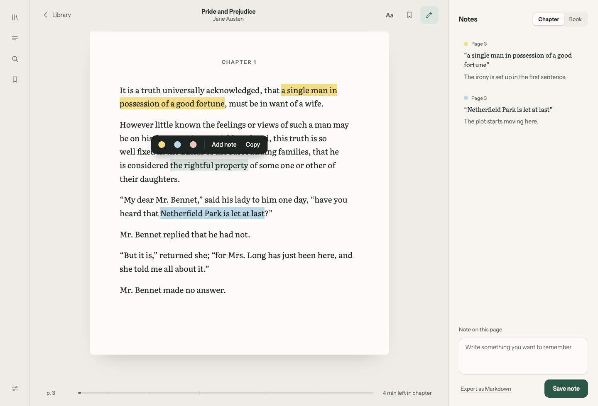
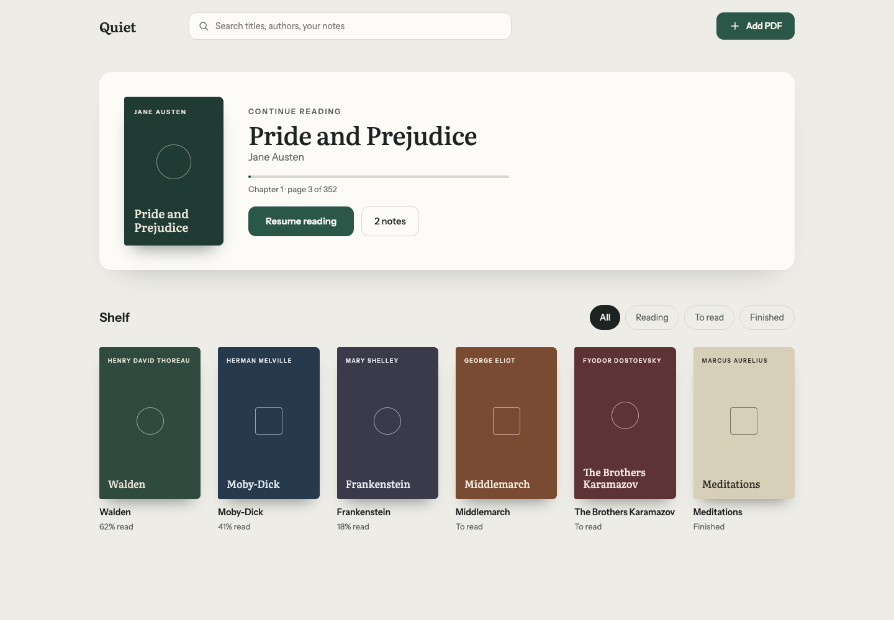
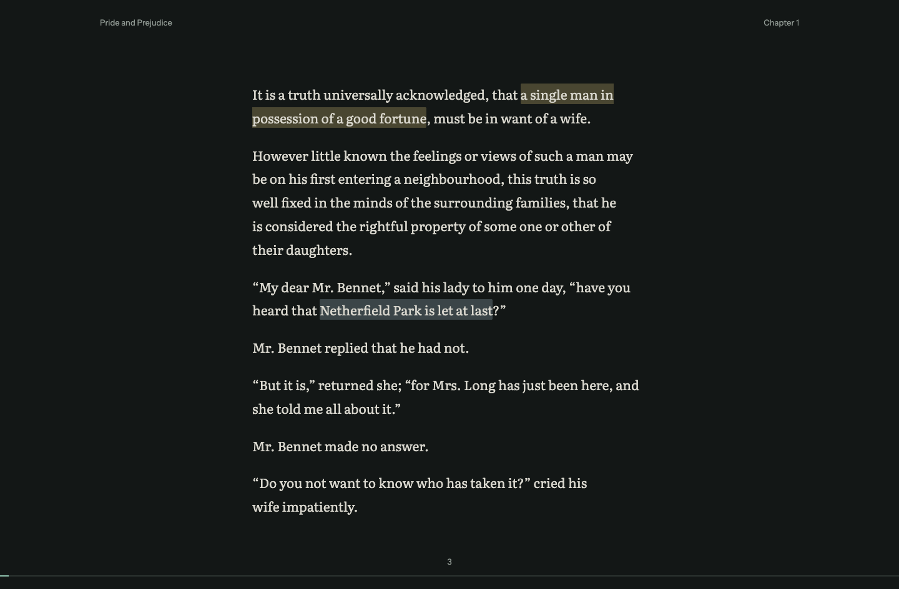

<p align="center">
  
</p>

<h1 align="center">Scholia</h1>

<p align="center"><em>σχόλια: notes in the margin.</em><br>
A fast, local-first PDF reader and editor for people who read a lot.</p>

Highlight passages, write notes beside them, and edit the PDF's own text, all in your browser.
There are no accounts and no server. Your files never leave your device.

> Status: **Phase 0** (foundations and technical spikes). See [PLAN.md](PLAN.md) for the full plan and roadmap.

## Design

The interface was designed in Claude Design. These are the design boards; the app follows them closely, with a few differences (for example, the design's working name was "Quiet", and its books are placeholders).

| Reader | Library |
|---|---|
|  |  |

**Focus mode**



## Requirements

- **Node.js 20.19+ or 22.12+** (required by Vite 8). Check with `node -v`.
- **npm** (comes with Node).
- **Google Chrome**, only for the end-to-end tests. Playwright uses your installed Chrome, so no browser download is needed.

## Run it

```bash
git clone <this repo> scholia
cd scholia
npm install
npm run dev
```

Open <http://localhost:5173>. You'll land on the **Library**. Click **Add PDF**, or drop a PDF anywhere on the page.

In development, the Library header also has **Sample** and **600 pages** buttons, which open the test PDFs in `fixtures/`.

### Production build

```bash
npm run build      # outputs a static site to dist/
npm run preview    # serves dist/ at http://localhost:4173
```

`dist/` is plain static files, so any static host works. It must be served over HTTP(S). Opening `index.html` from disk won't work, because the PDF and editor workers can't load from `file://`.

**Security headers.** The built `index.html` carries a Content Security Policy that stops the page from contacting any other site. A policy set in the page doesn't reach its background workers, though, so when hosting, also send it as an HTTP header (this covers the PDF and editor workers too) and forbid framing:

```
Content-Security-Policy: default-src 'self'; script-src 'self' 'wasm-unsafe-eval'; worker-src 'self'; connect-src 'self'; img-src 'self' data: blob:; font-src 'self' data:; style-src 'self' 'unsafe-inline'; object-src 'none'; base-uri 'none'; form-action 'none'; frame-ancestors 'none'
```

The policy is defined once, in `vite.config.ts` (`CSP`). Keep the header in step with it.

## Using Scholia

| Where | What you can do |
|---|---|
| **Library** | Search by title or author, filter the shelf (All / Reading / To read / Finished), and click **Resume reading** to return to the page you left. Hover a book (or tap the bin on a tablet) to remove it from this device along with its highlights and notes. |
| **Reader** | Scroll through pages, zoom, and follow your progress in the footer. **‹ Library** takes you back. |
| **Contents** | Open the table of contents from the left bar (or press `T`) and click an entry to jump to it. The section you're reading is highlighted as you scroll. It comes from the PDF's own outline, so PDFs without one show a short message instead. |
| **Highlights** | Select text, then click a colour in the dark toolbar or press `1`–`5`. Highlights can cross page breaks. Click a highlight to recolour or delete it. |
| **Notes** | Choose **Add note** on a selection, or write a note on the current page in the right-hand panel. **Export as Markdown** downloads every highlight and note. |
| **Edit text** | Press `E` (or the pencil in the left bar), click a line, type, then press `Enter`. **Download** saves the edited PDF, and the original is kept. |
| **Focus mode** | Press `F` to hide all controls and read in night colours. `Esc` exits. |

### Keyboard shortcuts

| Keys | Action |
|---|---|
| `1` – `5` | Highlight the selection (Important, Definition, Question, Disagree, Quote) |
| `E` | Toggle edit mode |
| `F` / `Esc` | Enter / leave Focus mode |
| `T` | Show or hide the table of contents |
| `Cmd/Ctrl` + `\` | Show or hide the notes panel |
| `Cmd/Ctrl` + `+` / `-` | Zoom in / out |
| `Cmd/Ctrl` + `Z` | Undo the last text edit |

### Where your data lives

Everything stays in your browser's storage for this site:

- **IndexedDB** stores your library: a copy of each PDF you open and your reading position.
- **localStorage** stores highlights and notes.

A PDF is kept from the first time you open it until you remove it from the Library (or clear this site's data in your browser). On a shared computer, remove anything sensitive when you're done. Use **Export as Markdown** to keep a copy of your notes.

## Development

```bash
npm test             # unit tests (Vitest): coordinate math and MuPDF text editing
npm run test:e2e     # browser tests (Playwright): highlighting, editing, 600-page performance
npm run check        # Svelte and TypeScript type checks
npm run fixtures     # regenerate the test PDFs in fixtures/
```

To save screenshots from the e2e tests, run `PW_SHOTS=/some/folder npm run test:e2e`.

> **Known issue:** `npm run check` currently reports `'test' does not exist in type 'UserConfigExport'` for `vite.config.ts`. The app code itself type-checks cleanly.

### Project layout

```
src/
  App.svelte                 app shell: Library ↔ Reader, shortcuts, Focus mode
  app.css                    design tokens (light + night palettes), fonts
  components/Icon.svelte     line icons
  features/library/          Library screen
  features/reader/           PDF viewer, pages, selection toolbar, notes panel
  lib/annotations/           highlight types, Markdown export
  lib/library/store.ts       IndexedDB library
  lib/pdf/                   coordinate maths, selection → anchors
  lib/editor/                MuPDF text editing (runs in a Web Worker)
  workers/mupdf.worker.ts
tests/e2e/                   Playwright tests
fixtures/                    generated test PDFs
```

## Stack

Svelte 5 · TypeScript · Vite · PDF.js (reading) · MuPDF.js (editing, lazy-loaded in a Web Worker) · Tailwind CSS · Instrument Sans and Literata (bundled, so they work offline)

## License

AGPL-3.0
